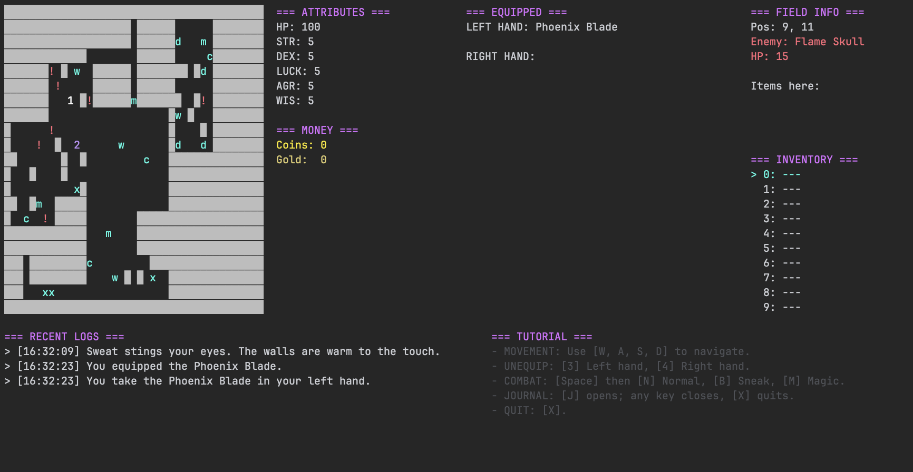

# Dungeon Crawler

Dungeon Crawler is a console-based multiplayer dungeon game written in C# and .NET. The project runs as either a TCP game server or a console client. The server owns the authoritative game state, while each client renders a local view of the game and sends keyboard input back to the server.

The codebase is structured around an MVC-style split and uses several object-oriented design patterns to keep game logic, networking, rendering, and input handling separated.

## Game Objective

The game currently has no defined objective or win condition. Players can explore the dungeon, collect items and currency, equip weapons, and fight enemies, but there is no final boss, completion screen, or victory trigger. Play continues until the player dies, exits, or the server stops.

## Requirements

- .NET 9 SDK (the `global.json` policy allows newer .NET 9 SDK feature bands and minor versions, but does not roll forward to .NET 10)
- A terminal/console that supports interactive keyboard input
- Network access between the server and client processes when running on different machines

The project targets `net9.0`.

## Gameplay Screenshot (client)



## Project Structure

```text
.
├── game.sln
├── global.json
├── config.json
└── game/
    ├── game.csproj
    ├── Client/
    │   ├── Models/
    │   ├── Networking/
    │   └── Views/
    ├── Server/
    │   ├── Bootstrap/
    │   ├── Commands/
    │   ├── Controllers/
    │   ├── Models/
    │   ├── Networking/
    │   └── Services/
    └── Shared/
        ├── DTOs/
        ├── Enums/
        ├── Events/
        └── Network/
```

## Build

Restore and build the solution from the repository root:

```bash
dotnet build game.sln
```

You can also run the project directly with `dotnet run` from the root by pointing to the project file.

## Running

The application has two modes: server and client. Start the server first, then connect one or more clients.

### Start a server

Default port:

```bash
dotnet run --project game/game.csproj -- --server
```

Custom port:

```bash
dotnet run --project game/game.csproj -- --server 5555
```

### Start a client

Connect to a local server:

```bash
dotnet run --project game/game.csproj -- --client 127.0.0.1:5555
```

Connect to a server on another machine:

```bash
dotnet run --project game/game.csproj -- --client SERVER_IP:5555
```

If no port is provided in client mode, the client defaults to port `5555`.

## Configuration

The entry point reads `config.json` from the process working directory, falling back to the copy beside the executable. The repository configuration is copied during build and publish. If the file is missing or invalid, default values are used.

Available configuration values are defined in `game/Shared/GameConfig.cs`:

```json
{
  "PlayerName": "Hero",
  "LogDirectory": "./Logs"
}
```

The repository currently includes an empty `config.json`, so the game uses defaults unless values are added.

`PlayerName` labels the log files; in-game names are assigned by the server as `Player 1`, `Player 2`, and so on.

## Controls

- `W`, `A`, `S`, `D`: move
- `E`: pick up an item
- `Up Arrow`, `Down Arrow`: select an inventory item
- `1`: equip selected item in the left hand
- `2`: equip selected item in the right hand
- `3`: unequip left hand
- `4`: unequip right hand
- `G`: drop selected item
- `Space`: open attack selection
- `N`: normal attack after pressing `Space`
- `B`: sneak/backstab attack after pressing `Space`
- `M`: magic attack after pressing `Space`
- `J`: open journal
- `X`: exit the client

## Map-Symbol Legend

| Symbol | Meaning | Color |
| --- | --- | --- |
| `█` | Wall; blocks movement | Terminal default |
| Blank space | Empty floor | Terminal default |
| Player ID (e.g. `1`, `2`) | Player position | Dark magenta for you; white for other players |
| `!` | Living enemy | Red |
| Item letter | An item on the floor; see theme-specific symbols below | Cyan |

Item symbols depend on the dungeon theme:

| Theme | Weapons | Artifact | Other items |
| --- | --- | --- | --- |
| Earthen Depths | `h`: Stone Hatchet; `m`: Granite Hammer; `c`: Claymore of Dust | `M`: Earthshaker | `o`: Heavy Pebble; `i`: Iron Ore |
| Howling Labyrinth | `r`: Wind-Razor; `d`: Feathered Dagger; `s`: Whistling Spear | `L`: Sky-Piercer | `f`: Feather; `e`: Cloud Essence |
| Inferno Forge | `d`: Searing Dagger; `m`: Obsidian Maul; `w`: Flame Whip | `P`: Phoenix Blade | `c`: Coal; `x`: Fire Crystal |

Rendering priority is player, then living enemy, then item, then terrain. If several items occupy one tile, only the first item's symbol is shown. Item effects such as Lucky and Strong preserve the original item's symbol.

## Architecture

### MVC Model

The project follows an MVC-inspired architecture:

- Model: game state and domain rules live mostly under `game/Server/Models`, `game/Client/Models`, and `game/Shared/DTOs`. Examples include `GameState`, `Board`, `Player`, `Enemy`, equipment, combat rules, dungeon generation, and client-side snapshot models.
- View: console rendering lives under `game/Client/Views`. Renderers such as `GameRenderer`, `BoardRenderer`, `InventoryRenderer`, `StatsRenderer`, `JournalRenderer`, and `LogView` are responsible for presenting the current client model.
- Controller: input handling and server orchestration live under `game/Server/Controllers` and `game/Server/Networking`. `ServerInputController` converts player key input into game actions, while `GameServer` processes queued commands and publishes state patches.

The server is authoritative. Clients send input DTOs to the server, the server updates its model, and then broadcasts patch DTOs back to clients. Clients apply patches to their local `ClientGameState` and redraw the console view.

### Client/Server Flow

1. The server starts a `ServerNetworkSession` and waits for TCP clients.
2. A client connects through `ClientNetworkSession`.
3. The server sends an initial snapshot and player assignment.
4. The client renders the received snapshot.
5. Keyboard input is sent as `PlayerInputDto`.
6. The server processes input through commands, handlers, systems, and rules.
7. Resulting `IGamePatch` objects are broadcast to clients.
8. Each client applies patches locally and redraws.

## Object-Oriented Patterns

The codebase uses several OOP patterns directly:

- Chain of Responsibility: `ServerInputController` builds a chain of `InputHandler` implementations, including `ExitHandler`, `JournalHandler`, `MovementHandler`, `PickupHandler`, `EquipmentHandler`, `DropHandler`, `SelectionHandler`, `AttackHandler`, and `UnknownHandler`. Each handler either processes a key or passes it to the next handler.
- Strategy: dungeon generation uses `DungeonStrategy` with implementations such as `StandardDungeonStrategy`, `DenseDungeonStrategy`, and `MazeDungeonStrategy`. Equipment behavior uses `IEquipStrategy` with one-handed and two-handed strategies. Combat actions use `IAttackHandler` with `NormalAttack`, `SneakAttack`, and `MagicAttack`.
- Decorator: item effects are layered through `ItemEffectDecorator`, with concrete effects such as `LuckyEffect` and `StrongEffect` wrapping an item while preserving the item/equipment interface.
- Observer/Event Dispatcher: `UiEventDispatcher` and `GameplayEventDispatcher` publish events to subscribed listeners. This decouples game systems from rendering and UI feedback.
- Command: network actions are represented as command objects such as `PlayerJoinCommand`, `PlayerInputCommand`, and `PlayerLeaveCommand`, which are queued by networking and consumed by the game server loop.
- Builder: dungeon creation is coordinated through `DungeonBuilder`, which exposes reusable generation steps used by different dungeon strategies.
- Adapter: the event dispatchers use typed listener adapters internally so strongly typed listeners can be stored and invoked through a common dispatcher interface.

Shared DTOs and `IGamePatch` implementations additionally carry snapshots and incremental updates between server and clients.

## Main Components

- `Program`: parses `--server` and `--client` arguments and starts the selected mode.
- `GameServer`: owns the game loop, receives queued commands, applies game logic, and broadcasts patches.
- `GameClient`: maintains the local client state, receives patches, reads keyboard input, and triggers rendering.
- `GameEngine`: coordinates server-side gameplay systems.
- `GameContext`: groups shared server state, systems, loggers, dispatchers, and theme data.
- `ServerNetworkSession` and `ClientNetworkSession`: handle TCP networking and JSON message exchange.
- `SnapshotToDtoMapper` and `SnapshotFromDtoMapper`: convert domain objects to/from network-friendly DTOs.

## Development Notes

Build verification:

```bash
dotnet build game.sln
```

Successful movement, pickup, equipment changes, drops, and attacks advance enemy movement. Opening the attack menu, viewing the journal, selecting inventory items, and failed actions do not consume a turn.

There are no automated tests in the current repository. Manual verification can be done by starting one server process and one or more client processes, then confirming that movement, inventory, equipment, combat, journal, and exit flows work across the network.
